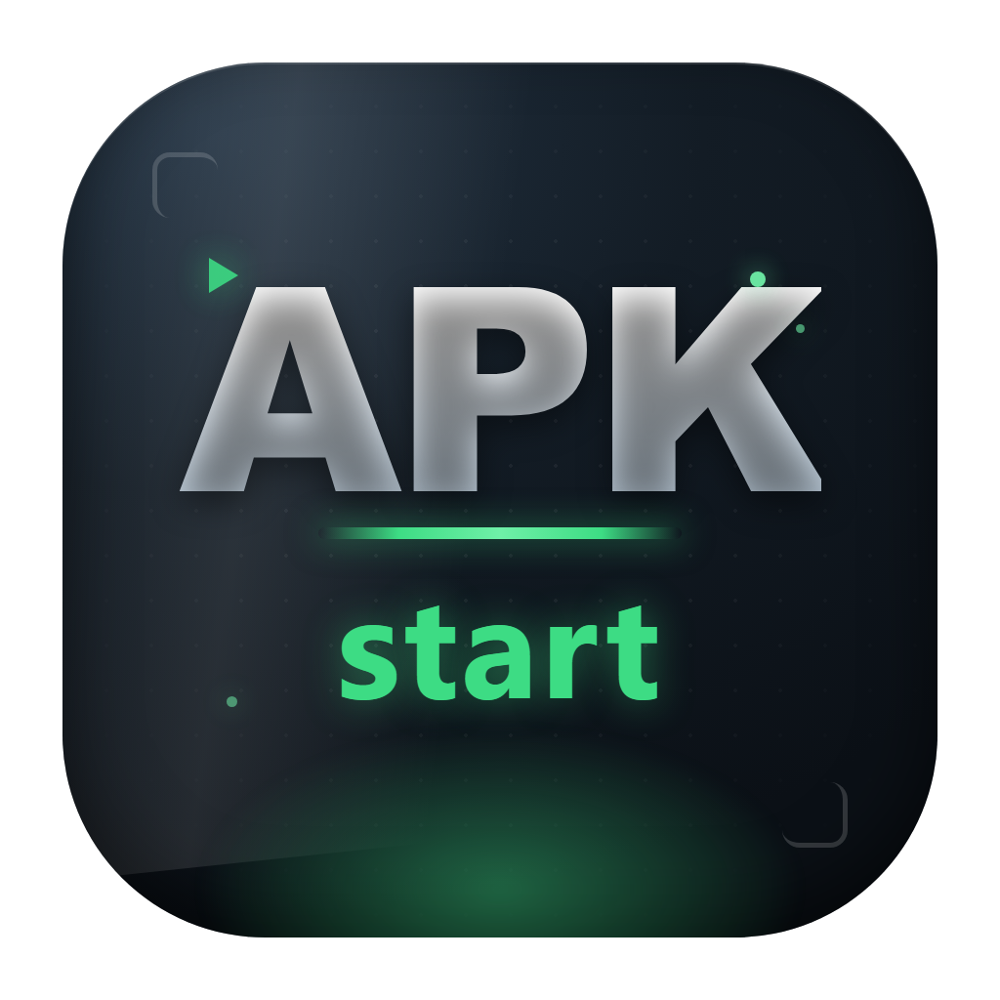
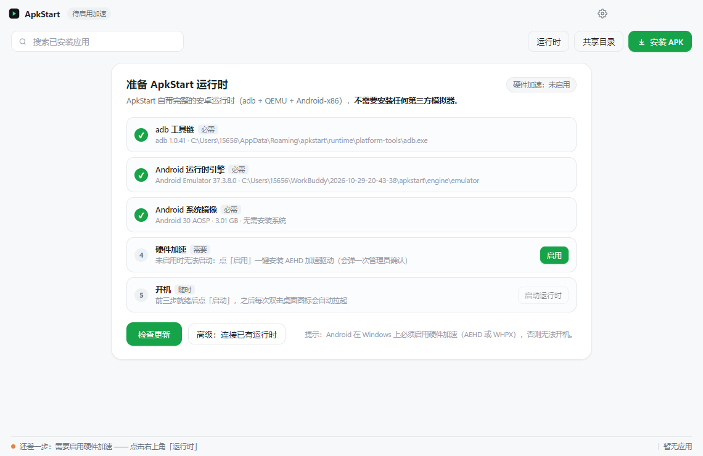
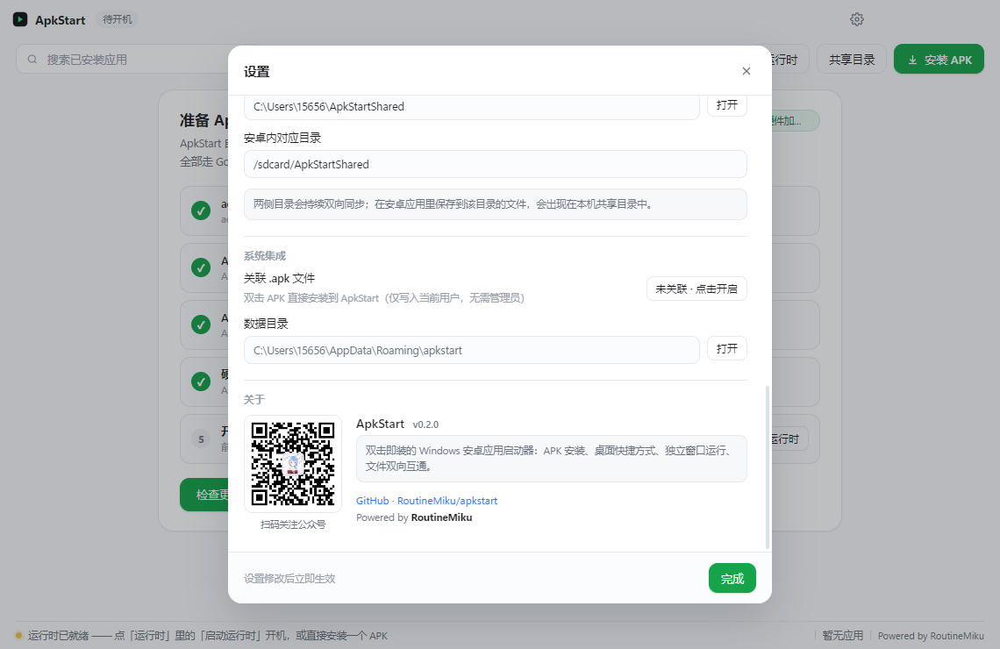

# ApkStart

<p align="center"></p>

[](https://github.com/RoutineMiku/apkstart/actions/workflows/ci.yml)
[](https://github.com/RoutineMiku/apkstart/releases)
[](LICENSE)
[](#)

[简体中文](README.md) | **Español**

**Ejecutor de apps Android para Windows: instala y usa apps Android como si fueran programas nativos de Windows.**
Nota: es una versión temprana, un proyecto personal del autor hecho en sus ratos libres después del trabajo y los fines de semana. Es de código abierto y gratuito, sin anuncios; todavía no es muy cómodo de usar y nunca se ha promocionado con cuentas de marketing.

- 🖱️ **Doble clic en un .apk y se instala**: con la asociación de archivos .apk registrada, haz doble clic en un APK en el Explorador y se analiza → instala → crea su icono en el escritorio, sin abrir ninguna interfaz de emulador.
- 🧩 **Un icono de escritorio por app**: el icono se extrae sin conexión del propio APK y se convierte a ICO de varios tamaños; doble clic en el icono = abre directamente esa app, igual que un programa nativo de Windows.
- 🪟 **Cada app es una ventana**: el runtime arranca en modo **con ventana** (en modo sin interfaz Android no emite VSYNC: el proceso de la app vive pero la pantalla queda vacía). ApkStart cambia el título de esa ventana, le pone el icono real de la app y la coloca con proporción vertical, convirtiéndola en una ventana de app independiente. **Pantalla completa** ocupa todo el alto de la pantalla, centrada; el **modo ventana** se puede mover y redimensionar libremente y recuerda el tamaño de cada app.
- 🔍 **Windows la encuentra**: al instalar se crean accesos directos en el escritorio y en el menú Inicio (`Programas\ApkStart\`); busca la app por su nombre en el menú Inicio y la barra de tareas la agrupa por app.
- 📁 **Archivos compartidos**: `%USERPROFILE%\ApkStartShared` ↔ `/sdcard/ApkStartShared` dentro de Android se sincronizan continuamente en ambos sentidos; lo que guarde una app Android aparece directamente en tu equipo.
- 🪶 **Extremadamente ligero**: la capa de la aplicación no tiene dependencias de terceros (incluso los analizadores de ZIP / PNG / ICO / AXML están escritos a mano); el runtime se lanza cuando hace falta y se libera solo en reposo. También puede reutilizar por completo un runtime Android que ya tengas en el equipo, sin ocupar nada extra.
- 🌐 **Interfaz en chino o en español**: en Ajustes → «Idioma · Language» puedes elegir 简体中文, Español o «Auto» (sigue el idioma del sistema). La traducción cubre la ventana principal, las ventanas de apps, el menú de la bandeja, las notificaciones y los cuadros de diálogo.


```
┌──────────────────────────────────────────────────────────────────┐
│  Icono del escritorio (.lnk con el icono real de la app)         │
│      │  doble clic                                               │
│      ▼                                                           │
│  ApkStart.exe --launch <paquete>                                 │
│      │  ¿runtime sin iniciar? → se lanza solo (Emulator + API34) │
│      ▼                                                           │
│  Se abre la entrada LAUNCHER que resuelve el sistema             │
│  (no la Activity principal declarada en el APK)                  │
│      │  18 s de vigilancia: si se cierra, reintenta / restablece │
│      │  datos / concede permisos                                 │
│      ▼                                                           │
│  Ventana del emulador = ventana de la app (título, icono,        │
│  proporción vertical, pantalla completa centrada)                │
└──────────────────────────────────────────────────────────────────┘
```

## Descargar y usar (sin compilar)

Las dos fuentes tienen el mismo contenido; desde China se recomienda Gitee:

- GitHub: [github.com/RoutineMiku/apkstart/releases](https://github.com/RoutineMiku/apkstart/releases)
- Gitee: [gitee.com/daily-miku/apkstart/releases](https://gitee.com/daily-miku/apkstart/releases) (mucho más rápido desde China)

Paquetes (tres formatos, con el mismo contenido y número de versión):

| Formato | Archivo | Cuándo elegirlo |
|---|---|---|
| Versión de la Store | `ApkStart_<versión de cuatro partes>_x64.msix` | Se instala desde Microsoft Store. Trae el runtime completo y no necesita internet tras instalar; las actualizaciones las gestiona la Store |
| Portable completa | `ApkStart-v*-win64-full.zip` (~830 MB, ~1.3 GB descomprimida) | **Si no quieres instalar ni esperar descargas**: descomprimir y usar; el runtime (emulador + imagen del sistema) va dentro |
| Instalable | `ApkStart-v*-Setup.exe` (~1.3 GB) | Si quieres accesos directos en el escritorio / menú Inicio y entrada de desinstalación |
| Portable ligera | `ApkStart-v*-win64-portable.zip` (96 MiB, ~227 MB descomprimida) | Solo para probar; descarga el runtime en el primer inicio |

> El `ApkStart.exe` de todos los formatos lleva **icono de la marca + recursos de versión** (FileDescription = `ApkStart 安卓应用运行器`,
> CompanyName = `RoutineMiku`, versión sincronizada con `package.json`), en lugar del icono predeterminado de Electron y la versión `33.x`.
> Para empaquetar tú mismo desde el código: `npm run pack` (ligera) / `npm run pack:full` (completa) / `npm run build:msix` (paquete de la Store).

### Cómo se consigue que la imagen ocupe toda la pantalla

La **orientación física del panel** del emulador (`hw.lcd.width/height`) es la forma real de la imagen. Si no coincide con la
`screenOrientation` que declara la app, Android solo le da una franja central tipo buzón, con bordes negros; ni cambiar el tamaño de la ventana,
ni `wm size`, ni el estilo de letterbox lo llenan (se probaron todas esas combinaciones; ver los comentarios de `src/core/apk.js`).

Por eso ApkStart **analiza `AndroidManifest.xml` sin conexión al instalar el APK** para saber si la app es de forma natural horizontal o vertical
(con más peso para la Activity de inicio; las que son todo `sensor` / `fullSensor` vuelven a preguntar a Android el valor real tras la primera ejecución), lo guarda en
`apps.json` y al iniciar elige el panel según eso:

- Apps verticales como Hongguo → panel vertical 720×1280, derecho, a pantalla completa, con density 190 (sw606dp) que además da el diseño de tablet;
- Apps horizontales como Molu → panel horizontal 1280×720, derecho, a pantalla completa.

Solo se reinicia el runtime la vez en que «la orientación del panel no coincide con la de la app» (unos 40 segundos; la barra de título lo avisa);
después las apps con la misma orientación abren al instante. El botón de rotación de la barra de título **recuerda** la orientación de esa app (las demás no se ven afectadas),
y en Ajustes → Ventana de la app → Orientación de pantalla se puede cambiar a «Horizontal forzado / Vertical forzado».

El diseño lo decide la «densidad lógica»: 720 de ancho a 190 dpi son **606 dp**, justo por encima del umbral de tablet de 600 dp de Android;
la página de episodios a dos columnas de Hongguo y los ajustes en paneles solo aparecen con esa densidad (los 320 dpi predeterminados de la imagen dan solo 360 dp, diseño de móvil).
Es el interruptor «Diseño de tablet» de los ajustes, activado por defecto; al desactivarlo vuelve el diseño de móvil.

### Actualización en línea (elige la fuente más rápida)

Ajustes → **Actualizaciones** → «Buscar actualizaciones», o clic derecho en la bandeja → «Buscar actualizaciones». Si hay una versión nueva, pulsa «Actualizar ahora».

- La versión instalable descarga `ApkStart-v*-Setup.exe` y lo instala en silencio;
- La versión ligera descarga `ApkStart-v*-win64-portable.zip` y, tras descomprimirlo, sobrescribe la **carpeta del programa**. La carpeta del runtime (`%APPDATA%\apkstart\runtime`), las apps instaladas y las instantáneas no están en la carpeta del programa, así que actualizar no hace perder nada;
- El reemplazo lo hace un script de PowerShell independiente (espera a que salga el proceso principal → sobrescribe → vuelve a abrir), así que **no aparece ningún aviso de «cierra el programa manualmente»** ni queda ninguna ventana de emulador en el escritorio.

La cadena de actualización no depende solo de GitHub: **cada vez mide y elige**:

1. Consulta a la vez la última versión en GitHub y en Gitee y se queda con la de número mayor (si una fuente tarda o está bloqueada, la otra sigue funcionando);
2. Hace una lista de candidatos con «conexión directa al origen / archivo con el mismo nombre en Gitee / prefijo de espejo» y descarga 256 KB reales de cada dirección para medir la velocidad,
   contando solo el rendimiento «después del primer byte» (el tiempo de conexión no cuenta; si no, una fuente con mucha latencia pero mucho ancho de banda parecería lenta);
3. Ordena por la velocidad medida y descarga desde la más rápida por bloques en paralelo; si falla, pasa a la siguiente automáticamente.

En Ajustes, «Fuentes de descarga y actualización» permite forzar una sola fuente (útil en redes de empresa que solo permiten un dominio),
desactivar los espejos públicos de aceleración o usar el prefijo de un espejo propio. Gitee limita cada adjunto a 100 MB;
el paquete portable comprimido con deflate de 7-Zip (`-mx=9`) pesa **95.0 MB**, así que en Gitee también es
un único paquete que se descomprime con doble clic (antes había que partirlo en `.part1/.part2` y unirlo a mano; esa versión ya está obsoleta).
Los paquetes con el mismo nombre en cada fuente no pesan exactamente lo mismo; el cliente elige una sola fuente según la medición y la descarga completa, sin mezclar.

Los dos repositorios son públicos y la lista de releases de Gitee se puede leer de forma anónima, sin rellenar ningún token.
(Solo si Gitee te limita y devuelve 403/429 hace falta poner en Ajustes un token de solo lectura para subir el límite.)


**Comportamiento predeterminado desde el primer momento** (sin buscar nada en Ajustes):

- Se inicia con Windows y se queda en la bandeja; doble clic en un icono del escritorio y entras directo en la app.
- Al instalar un APK se crean automáticamente accesos directos en el **escritorio y en el menú Inicio**, y la búsqueda de Windows encuentra la app por su nombre; los que faltaran de versiones anteriores se completan solos al iniciar.
- La ventana de la app se renderiza de forma nativa (no es una proyección): **pantalla completa** ocupa todo el alto, centrada, sin deformar la proporción del móvil; el **modo ventana** se mantiene en vertical, se puede mover y redimensionar, y recuerda el tamaño de cada app. Cambia en cualquier momento con `F11` o con clic derecho en la bandeja.
- Tras instalar se conceden automáticamente los permisos de runtime que pide la app, sin quedarse atascado en el diálogo de permisos; si la app se cierra sola, se reintenta automáticamente y, si hace falta, se restablecen sus datos antes de volver a abrirla.
- **La red usa directamente la de tu equipo**: Android sale por el NAT en modo usuario de QEMU, reutilizando la tarjeta de red física del equipo, y **no crea ninguna tarjeta ni conmutador de red virtual en Windows** (no hay que instalar controladores ni aparece un adaptador de red extra). No hace falta descargar nada ni cambiar ningún ajuste de red.

## Página de ajustes: por categorías y con búsqueda

Como cada vez hay más ajustes, desde la 0.6.0 la página se divide en ocho categorías según su uso, con una columna de navegación a la izquierda:

| Categoría | Qué contiene |
|---|---|
| Uso habitual e instalación | Runtime y entorno, hacerlo todo con un clic, inicio con Windows, uso de disco y limpieza |
| Pantalla y ventanas | Modo de pantalla, pantalla completa automática, orientación, rotación automática de la imagen, diseño de tablet, modo de ventana, ajustes del sistema Android |
| Controles y entrada | Botones del ratón, mapeo de teclado (mando) |
| Rendimiento y recursos | Política de recursos, calidad de imagen, partición de datos, idioma del sistema, método de entrada chino, instantáneas, precalentamiento, parámetros avanzados |
| Red y descargas | Actualizaciones y fuentes de descarga, espejos públicos de aceleración, hilos de descarga |
| Diagnóstico y reparación | Chequeo del equipo · configuración automática, drivers · parches de compatibilidad, detección automática · diagnóstico inteligente |
| Integración y archivos | Escritorio y apps, compartir archivos, integración con el sistema |
| Actualizaciones y acerca de | Actualización del programa, acerca de |

Arriba hay además un buscador: escribe palabras como «horizontal», «memoria» o «proxy» y los resultados se muestran **entre categorías**,
sin el problema de «lo encontró pero no lo veo». Se recuerda la última categoría visitada.

## Detección automática (debug automático)

Ajustes → **Diagnóstico y reparación** → «Detección automática · diagnóstico inteligente». Revisa el equipo periódicamente en segundo plano y lista los problemas por categoría:

- **Runtime**: la causa real del último fallo de inicio, arranque atascado, archivos de bloqueo residuales, procesos de emulador huérfanos, instantáneas vacías, sin aceleración por hardware
- **Conexión del dispositivo**: adb sin autorizar (Android mostró «¿Permitir la depuración USB?» y nadie pulsó), offline, el runtime funciona pero adb no ve el dispositivo
- **Almacenamiento**: espacio en disco, partición de datos configurada distinta de la real (el disco diferencial bloquea la ampliación), carpeta compartida sin escritura
- **Ajustes**: la política de orientación choca con el panel físico, la pantalla completa automática no funciona con ventana nativa
- **Red / registros**: Android sin red, fuentes de descarga caídas, errores en los registros recientes

Cada problema se puede resolver con un clic (reiniciar el runtime, borrar bloqueos, limpiar procesos huérfanos, invalidar la instantánea, liberar disco, restablecer la red de Android…),
y después se vuelve a comprobar automáticamente.

Dos principios: **un fallo al detectar no se trata como problema** (si no puede leer el estado dice «no se sabe», nunca inventa),
y **solo avisa una vez cuando aparece un problema nuevo** (los antiguos no vuelven a molestar; si se recuperan solo se anota en silencio).
Por defecto comprueba cada 10 minutos; en la misma página se puede desactivar o cambiar el intervalo.

## Compilar desde el código fuente

```powershell
# 1. Instalar dependencias (incluye el runtime de Electron)
npm install

# 2. Iniciar y completar el despliegue del runtime (descarga una vez adb / Android Emulator / imagen del sistema)
npm start

# 3. (Opcional) Registrar la instalación de .apk con doble clic
npm run assoc:on

# 4. Empaquetar la versión portable (sin instalación, lista para distribuir)
npm run pack
# Genera dist/ApkStart-win64-portable/ApkStart.exe
# 5. Comprimir en zip para publicar (usa este script, no Compress-Archive: pesa 5 MB más y no cabe en Gitee)
node build/zip.js dist/ApkStart-win64-portable ApkStart-win64-portable.zip
```

### EXE de un solo archivo (runtime completo incluido, sin internet tras instalar)

Si quieres «mandar un solo EXE y que la otra persona lo abra con doble clic sin esperar descargas», usa esto:

```powershell
# Primero prepara engine/ como runtime distribuible (system.img con compresión xz/LZMA2 máxima, 3.1 GB → ~1.1 GB;
# además recorta lo que el emulator no usa: QEMU arm64, backend Vulkan, paquetes de idioma, herramientas qsn/autodiagnóstico, recursos VR)
npm run runtime

# Luego genera el EXE instalable (destino nsis de electron-builder, se instala en la carpeta del usuario actual)
npm run build:exe
# Genera dist/release/ApkStart-<versión>-Setup.exe
```

Composición del tamaño (medida): Electron ~180 MB, emulator recortado ~480 MB, imagen del sistema comprimida con xz ~1.1 GB;
el instalador final pesa ~1.32 GB (unos 490 MB menos que con gzip). El límite real de compresión está en system.img
(es el propio sistema Android, una imagen protegida por verity, y no se le pueden quitar los componentes GMS desde fuera).
La red va por el NAT del equipo sin crear tarjetas de red virtuales, así que tampoco depende de controladores adicionales.

En el primer inicio la imagen xz se expande en `%APPDATA%\apkstart\system-images` (~20 segundos, solo una vez)
y después se reutiliza siempre. El AVD y las apps instaladas se guardan siempre en `%APPDATA%\apkstart\avd`,
así que no se pierden aunque la versión portable se descomprima cada vez en una carpeta temporal.

## Sobre el runtime: totalmente independiente, sin depender de emuladores de terceros

ApkStart es un proyecto **autosuficiente**: todos los componentes del runtime los descarga, verifica y gestiona él mismo (en `%APPDATA%\apkstart\runtime`).
La versión ligera descarga por defecto el paquete completo desde **la GitHub Release de este proyecto** (`ApkStart-runtime-*.zip`) y solo si no lo consigue recurre a las fuentes oficiales de la tabla:

| Componente | Origen | Tamaño | Uso |
|---|---|---|---|
| adb (platform-tools) | Fuente oficial dl.google.com | ~8 MB | Instalar / iniciar apps Android |
| Android Emulator | Fuente oficial dl.google.com (descarga en paralelo con 8 hilos) | ~440 MB | Motor del runtime (incluye modelo de dispositivo y traducción de GPU) |
| Imagen universal de Android 14 (Google Play x86_64) | Fuente oficial dl.google.com | Imagen original ~3.1 GB (~1.1 GB con xz) | Única capa base: ejecuta apps x86, apps solo ARM y GMS; la imagen es el sistema, no hay que instalarlo |
| Controlador AEHD (opcional) | Fuente oficial dl.google.com | ~0.2 MB | Aceleración por hardware (o la «Plataforma de máquina virtual» WHPX de Windows) |

En el primer uso, la página «Runtime» te guía para completar este despliegue (**despliegue con un clic**):
1. adb, el motor del runtime y la imagen del sistema se descargan solos (más de 10 MB/s medidos en la fuente oficial);
2. Al terminar **arranca automáticamente**, y después el doble clic en un icono del escritorio lo lanza solo, sin que notes nada.



**Compatibilidad de dispositivos (automática, sin intervención)**

- Sin aceleración por hardware se usa automáticamente emulación por software; si el arranque falla, se reintenta solo con hasta 4 combinaciones de parámetros siguiendo «backend de renderizado → tipo de aceleración → memoria / arranque en frío».
- `-gpu` se elige según la versión del motor (`software` en 37.x, `swiftshader_indirect` en versiones antiguas); ya no se usan modos obsoletos.
- Memoria y núcleos se deducen de la memoria física (2–4 GB / 2–4 núcleos); la partición de datos baja de 16 GB a 4 GB; el puerto se elige dinámicamente entre los libres, las rutas en chino se convierten a rutas cortas y los archivos de bloqueo del AVD se limpian solos.
- La causa de cada fallo se explica en lenguaje claro (en chino o en español) junto con una sugerencia para arreglarlo; en Ajustes puedes «Exportar informe de diagnóstico».
- Los archivos grandes se descargan por defecto con **8 hilos por bloques + reanudación**; las fuentes que no admiten Range pasan automáticamente a una sola conexión.
- **Solo usa su propio runtime, sin relación con otros emuladores**: ApkStart no detecta, no toma el control ni maneja MuMu / LDPlayer / BlueStacks / WSA instalados en tu equipo;
  que estén o no instalados, cómo se actualicen o qué puertos usen no afecta a ApkStart. Los ajustes ya no ofrecen «cambiar de motor».
- **Chequeo del equipo · configuración automática**: tras instalar revisa la virtualización de la CPU (VT-x/SVM), la Plataforma del hipervisor de Windows,
  la tarjeta gráfica y su VRAM, la memoria y la versión del sistema; lo que se puede cambiar automáticamente (memoria / núcleos / calidad / backend de renderizado) se escribe en los ajustes y se guarda como driver,
  lo que requiere administrador tiene un botón y lo que solo se cambia en la BIOS te explica cómo. Ver [docs/preflight.md](docs/preflight.md).
- **Extensión de drivers (parches de compatibilidad)**: si un equipo necesita cambiar parámetros de arranque para funcionar (tarjeta gráfica antigua con GLES bajo, sin aceleración por hardware,
  un controlador que falla con renderizado por hardware), puedes escribir un parche JSON que declare a qué equipos se aplica y qué parámetros cambia.
  En los ajustes se pueden importar, activar y exportar una plantilla del equipo; los parches solo cambian opciones de arranque de una lista permitida y no ejecutan código. Ver [docs/drivers.md](docs/drivers.md).

**Ejecución tipo contenedor de bajo coste**

- **Capa base de solo lectura**: una sola `system-images/` para todo el equipo, compartida por todas las apps; ya no se guardan a la vez dos imágenes (AOSP + compatibilidad).
- **Capa escribible fina**: un único AVD con datos de usuario diferenciales + instantánea quickboot con nombre; al cerrar la última ventana de app (en reposo) el estado de memoria se guarda como instantánea y el siguiente arranque la restaura en lugar de arrancar en frío.
- **Precalentado en reposo (activado por defecto)**: como WSA o la versión de PC de Tencent App Store, ApkStart prepara el entorno Android en segundo plano en cuanto se abre (con la ventana oculta todo el tiempo); al tocar una app solo queda un `am start`. A cambio se quedan ~1 GB de RAM residentes en reposo; se puede desactivar en Ajustes.
- **Arranque en frío más rápido**: los resultados de detección de aceleración y de versión del motor se guardan en caché en disco (se invalidan según la huella del exe), se evita la enumeración innecesaria de procesos con `wmic`, la detección de arranque usa intervalos adaptativos (desde 350 ms) y los comandos de preparación del lado guest se agrupan en un solo viaje de adb; cada inicio espera 5–10 segundos menos.
- **ApkStart crea su propio `/data`**: el `userdata.img` de la imagen oficial es solo un marcador de 1 MB lleno de ceros; el formateo real lo hacían las herramientas del SDK. Si se lanza `emulator.exe` directamente se salta ese paso, `/data` no se monta y el guest cae en un bucle de reinicios en recovery: «espero varios minutos y sigue sin abrir». Ahora, en el primer inicio, genera un ext4 con bloques de 4 KB, `ENCRYPT` (cifrado a nivel de archivo) y `ext_attr` (etiquetas SELinux), y lo amplía a la capacidad configurada con su propio `qemu-img` + `resize2fs`. Medido: arranque en frío ~23 s, con instantánea ~10 s.
- Verificación de integridad de instantáneas: se detectan y limpian las carcasas vacías que deja un guardado interrumpido (un `snapshot.pb` de pocas decenas de bytes); el emulator nuevo escribe `ram.bin` (el antiguo `ram.img`) y se reconocen ambos nombres, así que ya no se borra por error una instantánea de 3 GB recién guardada.
- **La ventana de comandos no aparece nunca**: la consola de qemu pertenece a `conhost.exe`, cuyo pid no coincide con el de qemu, así que una lista blanca por pid no ocultaba ninguna; además el demonio de red del emulador, `netsimd`, abre su propia ventana negra. Ahora la supresión residente se activa **antes** de lanzar el emulador, con respaldo por clase/título de ventana (emulator / qemu / netsim) + un barrido cada 120 ms durante los primeros 90 segundos de arranque.
- **Al abrir el programa solo ves el programa**: la ventana principal del emulador (`Android Emulator - apkstart5554`) nunca aparece sola en el escritorio: o está suprimida y oculta, o ya está incrustada con `SetParent` en la ventana de la app. Al cerrar la ventana de la app, **primero** se desengancha de la ventana anfitriona y se oculta, y **después** se destruye la anfitriona (en el orden inverso Windows la vuelve a colgar del escritorio y la muestra); tras salir la app, el agente de ventanas sigue «vigilando» hasta 3 minutos para que un emulador que salió a medio arranque no muestre una ventana negra decenas de segundos después.
- **Descarga bajo demanda**: la imagen universal solo se completa cuando aparece una app con bibliotecas nativas solo ARM; los paquetes divididos `.apks` / `.xapk` se instalan automáticamente con `install-multiple`.
- **Recuperable**: al compilar se eliminan los destinos de QEMU que no son x86_64 (~400 MB); la página de Ajustes puede limpiar imágenes antiguas, instantáneas antiguas, archivos de bloqueo y AVD heredados.

## Estructura de carpetas

```
apkstart/
├─ src/
│  ├─ main.js              Proceso principal: ventanas/bandeja/instancia única/línea de comandos/IPC
│  ├─ preload.js           Puente seguro
│  ├─ ui/                  Capa de renderizado (HTML/CSS/JS nativo, sin frameworks)
│  ├─ i18n/                Idiomas de la interfaz (i18n.js: motor; es.js: diccionario español)
│  └─ core/
│     ├─ zip.js            Lector ZIP mínimo (descompresión bajo demanda)
│     ├─ axml.js           Analizador de XML binario de Android
│     ├─ arsc.js           Analizador de la tabla resources.arsc (nombre de app / ruta del icono)
│     ├─ apk.js            Metadatos del APK: paquete/versión/Activity de inicio/icono/ABI
│     ├─ png.js            Codificador PNG sin dependencias + dibujo de iconos
│     ├─ shortcut.js       Generación de ICO multitamaño + accesos directos .lnk
│     ├─ assoc.js          Asociación de archivos .apk (HKCU, sin administrador)
│     ├─ adb.js            Cliente adb (instalar/iniciar/sincronizar/capturas/…)
│     ├─ engine.js         Gestión del runtime: detección/control del emulador/liberación en reposo
│     ├─ sharer.js         Sincronización bidireccional de la carpeta compartida equipo ↔ Android
│     ├─ installer.js      Orquestación del proceso de instalación
│     └─ store.js          Persistencia de la lista de apps y los ajustes
├─ engine/                 Caché de descarga de los componentes del runtime (emulator / system-images / platform-tools)
├─ tools/platform-tools/   Ubicación del adb portable
├─ test/                   Pruebas unitarias + pruebas de integración con Electron + capturas de humo
├─ build/pack.js           Empaquetado de la versión portable
└─ scripts/assoc.js        Interruptor de línea de comandos para la asociación de .apk
```

## Línea de comandos

```
ApkStart.exe                      Abre la ventana principal
ApkStart.exe <ruta\a.apk>         Instala el APK
ApkStart.exe --launch <paquete>   Inicia la app directamente (lo usan los accesos directos del escritorio)
```

## Pruebas

```powershell
npm test                                   # Pruebas unitarias en Node + pruebas de la cadena del motor + i18n (sin red)
npm run test:boot                          # Prueba de arranque real: con un guest Alpine de 61 MB verifica parámetros de QEMU / creación de disco / apagado ordenado
npm run selftest                           # Autodiagnóstico del runtime: con Android instalado verifica instalar → iniciar → capturar → carpeta compartida
electron test/electron-integration.js      # Pruebas de integración de ICO / accesos directos
electron . --smoke test\shot.png           # Inicia la app y hace una captura (prueba de humo de la interfaz)
```

`npm run selftest` es el «comando de aceptación» tras instalar el sistema: comprueba en orden, en el dispositivo actual, la conexión adb,
la versión de Android, el soporte de freeform y la sincronización bidireccional de la carpeta compartida; con `--apk alguna-app.apk` recorre además
todo el flujo instalar → iniciar en ventana independiente → confirmar primer plano → captura.

## Decisiones de diseño (con franqueza)

- **No es un hipervisor hecho desde cero**: el kernel de Android, la traducción de GPU y el runtime ART son proyectos de años; este proyecto se apoya en AOSP/QEMU/adb y concentra el esfuerzo en la «experiencia de app nativa». Es la misma arquitectura que usan productos como la versión de PC de Tencent App Store o Google Play Games para PC.
- **La carpeta compartida se sincroniza, no se monta**: sin root, Windows no puede montar una carpeta NTFS dentro de Android, así que se usa una sincronización bidireccional al segundo que da la misma experiencia.
- **Apps solo ARM / apps de ByteDance**: activa en Ajustes el «Modo de compatibilidad ARM» para cambiar a la **imagen Google Play de Android 14 (API 34)** (con la nueva capa de traducción ndk_translation integrada); así se pueden instalar y ejecutar apps que solo traen bibliotecas nativas ARM. **Probado: Hongguo, la app gratuita de microdramas (com.phoenix.read, solo arm64-v8a), se instala, entra en el feed de recomendaciones y reproduce vídeo con normalidad.** En la antigua imagen API 30 el manejador de señales no estándar que incluyen las apps de ByteDance activaba una aserción de protección en la capa de traducción (`DoBadTrampoline` SIGABRT); la nueva capa de la imagen de Android 14 ya lo corrige. Algunas apps traen detecciones anti-emulador más profundas (como exigir sensores o baseband reales) y pueden seguir limitadas; si la instalación falla o la app se cierra al iniciar, ApkStart muestra una explicación clara.

| Hongguo (microdramas gratis) en modo de compatibilidad (Android 14 · aceleración por hardware AEHD) |
|:---:|
|  |

### Qué hacer si aparece «Aceleración por hardware no activada»

En Windows el emulador de Android solo tiene dos vías de aceleración:

| Vía | Qué es | Cuándo pide administrador | ¿Hay que reiniciar? |
|---|---|---|---|
| **WHPX** | La característica de Windows «Plataforma del hipervisor de Windows» | Al activarla | Sí |
| **AEHD** | El controlador de kernel de Google | Al instalarlo | No |

- **Versión instalable / portable**: Ajustes → Autodiagnóstico del entorno → pulsa **Reparar** junto a «Aceleración por hardware no activada»; aparece un aviso UAC y se activa WHPX automáticamente. Si no se puede (el sistema no lo admite o pulsaste «No»), se instala automáticamente el controlador AEHD.
- **Versión de Microsoft Store (MSIX)**: las apps de la Store **no pueden elevar privilegios**, así que «Reparar» abre directamente el diálogo «Activar o desactivar las características de Windows»; marca
  **«Plataforma del hipervisor de Windows»** (HypervisorPlatform en inglés), acepta y **reinicia el PC** una vez.

  También puedes hacerlo desde un PowerShell de administrador:

  ```powershell
  dism /online /enable-feature /featurename:HypervisorPlatform /all /norestart
  dism /online /enable-feature /featurename:VirtualMachinePlatform /all /norestart
  ```

> Ojo: no actives solo la «Plataforma de máquina virtual (VirtualMachinePlatform)»; esa es la que usa WSL2. El emulador necesita la
> **«Plataforma del hipervisor de Windows (HypervisorPlatform)»**. Con solo la primera, `emulator -accel-check` seguirá diciendo que no está disponible.
>
> Sin aceleración también funciona (emulación por software), pero el arranque tarda minutos; para eso sirve el aviso de la app,
> no es un fallo de inicio.

### El icono del escritorio es incorrecto o sale el de ApkStart

El acceso directo de cada app Android debería usar **su propio icono** (al instalar se extrae del APK y se guarda en
`%APPDATA%\apkstart\icons\<paquete>.ico`). Si sale el botón verde de reproducir de ApkStart, o un icono en blanco:

1. **Ajustes → Integración con el sistema → Recrear accesos directos** (reescribe los accesos directos del escritorio y del menú Inicio según la lista actual de apps,
   arreglando a la vez el icono y la identidad en la barra de tareas);
2. Si sigue mal, borra ese acceso directo y en ApkStart haz clic derecho en la app → recrear el acceso directo / reinstalarla.

> Por qué se estropea: versiones antiguas, al reorganizar los iconos, apuntaron el `IconLocation` de esos `.lnk` al icono de ApkStart;
> además, si mueves la carpeta de la versión portable a otro sitio, las rutas absolutas guardadas en los `.lnk` dejan de valer. Basta con recrearlos.
>
> De paso: cada acceso directo lleva su propio AppUserModelID,
> así que al **anclarlo a la barra de tareas** el botón y el elemento anclado usan el mismo icono de la app y no se mezclan con ApkStart.

### Por qué mi `adb devices` no ve este dispositivo Android

El servidor adb de ApkStart funciona en un **puerto propio, 5044**, totalmente separado del adb de tu sistema (5037): así Android Studio / scrcpy no se pelean con él por el dispositivo y él no cierra por error los emuladores que abras a mano.

Para conectarte desde la línea de comandos:

```powershell
$env:ANDROID_ADB_SERVER_PORT = 5044
adb devices              # verás emulator-5554
```

⚠️ **No** hagas `adb connect` a mano contra el puerto `5555`: la imagen con Play muestra el diálogo del sistema «¿Permitir la depuración USB?», y aparece encima de la app Android en ejecución, como si el programa hubiera fallado.

## Sobre el autor

ApkStart lo desarrolla y mantiene **RoutineMiku**.

- GitHub: <https://github.com/RoutineMiku/apkstart>
- Cuenta oficial de WeChat: escanea el código para seguirla

<p align="center"></p>

<p align="center"><i>Powered by <b>RoutineMiku</b></i></p>

## Contribuir

Se agradecen Issues y PR. La capa de la aplicación se mantiene sin dependencias de terceros; ejecuta `npm test` antes de enviar cambios. Más detalles en [CONTRIBUTING.md](CONTRIBUTING.md).

Para añadir o corregir traducciones al español, edita `src/i18n/es.js`: la clave es el texto original en chino tal como aparece en el código y el valor es la traducción (`{0}`, `{1}`… son las partes dinámicas). Si falta una entrada, la interfaz simplemente muestra el texto en chino.

## Licencia

[MIT](LICENSE). Los paquetes publicados solo contienen el código de ApkStart y el runtime de Electron; no se distribuyen imágenes del sistema Android, binarios de QEMU ni componentes de Google. Estos se descargan bajo demanda desde sus fuentes oficiales en el equipo del usuario durante el primer inicio, y se rigen por sus respectivas licencias.
