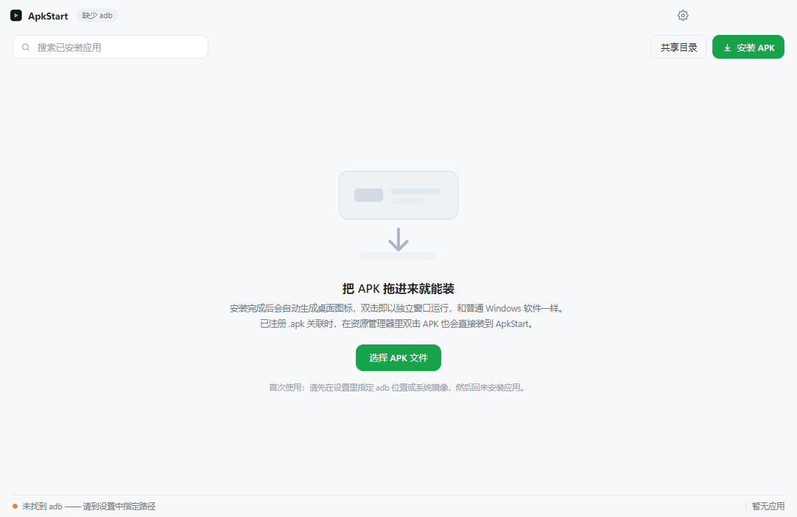
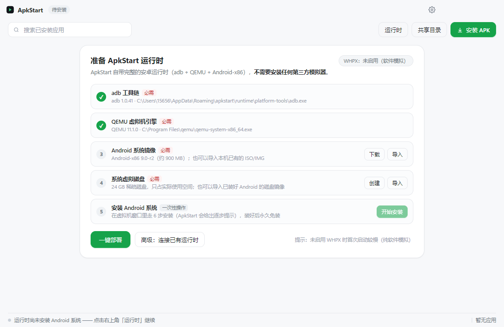

# ApkStart

[](https://github.com/RoutineMiku/apkstart/actions/workflows/ci.yml)
[](https://github.com/RoutineMiku/apkstart/releases)
[](LICENSE)
[](#)

**Windows 上的安卓应用运行器 —— 让安卓应用像 Windows 原生软件一样被安装和使用。**

- 🖱️ **双击 .apk 即安装**：注册 .apk 文件关联后，在资源管理器里双击 APK，自动解析 → 安装 → 生成桌面图标，全程无需打开任何模拟器界面。
- 🧩 **每个应用一个桌面图标**：图标从 APK 内部离线提取并转为多尺寸 ICO，双击桌面图标 = 直接启动该应用，与打开一个原生 Windows 软件的体验一致。
- 🪟 **独立窗口（freeform）**：通过 `--windowingMode 5` 以自由窗口模式启动，每个安卓应用都有自己的窗口，可拖动、缩放、固定在任务栏。
- 📁 **数据互通**：`%USERPROFILE%\ApkStartShared` ↔ 安卓内 `/sdcard/ApkStartShared` 持续双向同步，安卓应用存下的文件直接出现在本机。
- 🪶 **极致轻量**：壳层本身零第三方依赖（连 ZIP / PNG / ICO / AXML 解析都是手写的），运行时按需拉起，空闲自动回收；也可以完全复用你机器上已有的安卓运行时，额外占用为零。



```
┌────────────────────────────────────────────────────────────┐
│  桌面图标（真实应用图标 .lnk）                              │
│      │  双击                                               │
│      ▼                                                     │
│  ApkStart.exe --launch <包名>                              │
│      │  运行时未启动？→ 自动拉起（QEMU / 复用已有模拟器）   │
│      ▼                                                     │
│  adb am start --windowingMode 5 -n <包名>/<Activity>       │
│      │                                                     │
│      ▼                                                     │
│  独立 freeform 窗口，像原生应用一样使用                     │
└────────────────────────────────────────────────────────────┘
```

## 下载即用（不想编译）

到 [Releases](https://github.com/RoutineMiku/apkstart/releases) 下载 `ApkStart-v*-win64-portable.zip`，解压后双击 `ApkStart.exe` 即可。
首次启动进入「运行时」页点**一键部署**，会自动装好 adb / QEMU / 安卓系统镜像，之后长期免装。

## 从源码构建

```powershell
# 1. 安装依赖（含 Electron 运行时）
npm install

# 2. 启动并完成运行时部署（一键下载 adb / QEMU / 系统镜像）
npm start

# 3.（可选）注册 .apk 双击安装
npm run assoc:on

# 4. 打包便携版（免安装，可直接分发）
npm run pack
# 产出 dist/ApkStart-win64-portable/ApkStart.exe
```

## 运行时说明：完全独立，不依赖任何第三方模拟器

ApkStart 是一个**自持**的项目，运行时组件全部由自己下载、校验和管理（位于 `%APPDATA%\apkstart\runtime`）：

| 组件 | 来源 | 大小 | 用途 |
|---|---|---|---|
| adb（platform-tools） | dl.google.com 官方源 | ~8 MB | 安装/启动安卓应用 |
| QEMU | 官方 Windows 构建，静默安装 | ~200 MB | 虚拟机引擎 |
| Android-x86 9.0-r2 | 多镜像源（支持续传） | ~900 MB | 安卓系统 |
| 虚拟磁盘 | qemu-img 自建（qcow2 稀疏） | 24 GB（按需占用） | 系统与用户数据 |

首次使用时，「运行时」页会引导完成以上部署（**一键部署**），然后走一次性系统安装；
之后每次启动直接从磁盘引导，装/开应用全程无感。



- 支持 **WHPX 硬件加速**（在「启用或关闭 Windows 功能」勾选「虚拟机平台」后自动启用），未启用时自动回退纯软件模拟。
- 高级用户也可以在设置里切换为「连接已有运行时」（复用 WSA 等的 adb 端口），但这只是可选项，不是依赖。
- 自备镜像的用户可直接导入 ISO/IMG/已装好的虚拟磁盘，跳过下载。

## 目录结构

```
apkstart/
├─ src/
│  ├─ main.js              主进程：窗口/托盘/单实例/命令行分发/IPC
│  ├─ preload.js           安全桥接
│  ├─ ui/                  渲染层（原生 HTML/CSS/JS，无框架）
│  └─ core/
│     ├─ zip.js            极简 ZIP 读取器（按需解压）
│     ├─ axml.js           Android 二进制 XML 解析
│     ├─ arsc.js           resources.arsc 资源表解析（应用名/图标路径还原）
│     ├─ apk.js            APK 元信息：包名/版本/启动 Activity/图标/ABI
│     ├─ png.js            零依赖 PNG 编码器 + 程序图标绘制
│     ├─ shortcut.js       多尺寸 ICO 生成 + .lnk 快捷方式
│     ├─ assoc.js          .apk 文件关联（HKCU，免管理员）
│     ├─ adb.js            adb 客户端（安装/启动/同步/截图/…）
│     ├─ engine.js         运行时管理：探测/QEMU 托管/空闲回收
│     ├─ sharer.js         本机 ↔ 安卓共享目录双向同步
│     ├─ installer.js      安装流水线编排
│     └─ store.js          应用清单与设置持久化
├─ engine/                 QEMU 引擎放置处（见 engine/README.md）
├─ tools/platform-tools/   便携 adb 放置处
├─ test/                   单元测试 + Electron 集成测试 + 冒烟截图
├─ build/pack.js           便携版打包
└─ scripts/assoc.js        .apk 关联命令行开关
```

## 命令行

```
ApkStart.exe                      打开主界面
ApkStart.exe <路径\to.apk>        安装 APK
ApkStart.exe --launch <包名>      直接启动应用（桌面快捷方式使用此参数）
```

## 测试

```powershell
npm test                                   # 纯 Node 单元测试
electron test/electron-integration.js      # ICO / 快捷方式集成测试
electron . --smoke test\shot.png           # 启动应用并截图（界面冒烟）
```

## 设计取舍（诚实说明）

- **不是从零实现的 hypervisor**：安卓内核、GPU 转译、ART 运行时是数年级别的工程，本项目选择站在 AOSP/QEMU/adb 的肩膀上，把工程量集中在「原生应用级体验」上——这正是应用宝电脑版、Google Play Games PC 版等产品共同的架构思路。
- **共享目录是同步而非挂载**：Windows 无 root 时无法在安卓侧挂载 NTFS 目录，采用秒级双向同步达到同等体验。
- **ARM-only 应用**：若应用仅含 ARM 原生库，需要运行时支持 ARM 转译（Bliss/部分镜像可开启 libhoudini/NativeBridge），安装时 ApkStart 会给出提示。

## 参与贡献

欢迎 Issue / PR。壳层保持零第三方依赖，提交前请跑 `npm test`；细节见 [CONTRIBUTING.md](CONTRIBUTING.md)。

## 许可证

[MIT](LICENSE)。本项目不分发安卓系统镜像、QEMU 二进制或 Google 组件，这些均由用户本机按需下载并遵循各自的许可协议。
