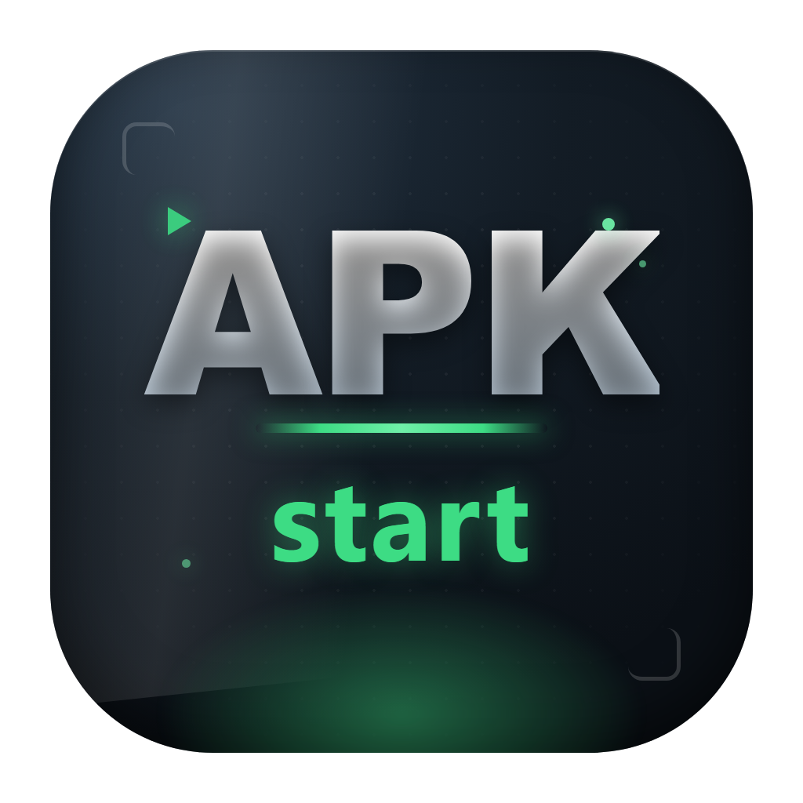

# ApkStart

<p align="center"></p>

<p align="center">
  <a href="README.md">简体中文</a> | 
  <a href="README_en.md">English</a> | 
  <a href="README_ar.md"><b>العربية</b></a>
</p>

[](https://github.com/RoutineMiku/apkstart/actions/workflows/ci.yml)
[](https://github.com/RoutineMiku/apkstart/releases)
[](LICENSE)
[](#)

**مشغّل تطبيقات أندرويد لنظام ويندوز — لتثبيت وتشغيل تطبيقات أندرويد تماماً كبرامج ويندوز المكتبية الأصلية.**

- 🖱️ **تثبيت ملفات .apk بالنقر المزدوج**: بمجرد ربط امتداد `.apk`، يكفي النقر المزدوج على أي ملف APK في مستكشف ملفات ويندوز ليتم تحليله تلقائياً ← تثبيته ← وإنشاء اختصار له على سطح المكتب، دون الحاجة لفتح واجهات محاكيات تقليدية.
- 🧩 **أيقونة سطح مكتب مستقلة لكل تطبيق**: يتم استخراج الأيقونات الأصلية بجودة عالية من حزمة APK دون اتصال وتحويلها إلى ملفات `.ico` متعددة الأحجام. النقر على الأيقونة يفتح التطبيق مباشرة كنافذة مستقلة كأي برنامج ويندوز أصلي.
- 🪟 **التطبيق عبارة عن نافذة مستقلة**: يعمل التطبيق بنمط النوافذ المستقلة؛ يضبط ApkStart عنوان النافذة ويضع أيقونة التطبيق الحقيقية ويحافظ على أبعاد الهاتف. يدعم **ملء الشاشة** الكامل دون تشويه، و**نمط النافذة الحرة** مع تذكر أبعاد النافذة وموقعها لكل تطبيق على حدة.
- 🔍 **قابل للبحث في قائمة ابدأ**: يُنشئ اختصارات تلقائية على سطح المكتب وفي قائمة ابدأ (`Programs\ApkStart\`)، مما يتيح لك البحث عن التطبيق وتشغيله مباشرة من شريط مهام ويندوز.
- 📁 **مشاركة فورية للملفات بالاتجاهين**: مزامنة تلقائية مستمرة بين مجلد `%USERPROFILE%\ApkStartShared` على حاسوبك ومسار `/sdcard/ApkStartShared` داخل أندرويد.
- 🌐 **دعم كامل ومتكامل للغات**: واجهة مترجمة بالكامل إلى **العربية (مع دعم كامل لاتجاه اليمين إلى اليسار RTL)**، **الإنجليزية (`en`)**، و**الصينية (`zh`)**، مع إمكانية التبديل الفوري من نافذة الإعدادات دون الحاجة لإعادة تشغيل البرنامج.
- 🪶 **خفيف وسريع للغاية**: هيكل البرنامج الأساسي مبني بدون أي مكتبات خارجية طرف ثالث (Zero Runtime Dependencies)، حيث كُتبت أدوات فك ضغط ZIP وتوليد PNG/ICO وتحليل AXML برمجياً من الصفر.


```
┌────────────────────────────────────────────────────────────┐
│  اختصار سطح المكتب (أيقونة التطبيق الحقيقية .lnk)          │
│      │  نقر مزدوج                                          │
│      ▼                                                     │
│  ApkStart.exe --launch <اسم الحزمة>                         │
│      │  بيئة التشغيل متوقفة؟ → تشغيل تلقائي (QEMU + API 34) │
│      ▼                                                     │
│  بدء التطبيق عبر نقطة الدخول LAUNCHER المستخرجة من النظام   │
│      │  مراقبة الإقلاع؛ إعادة محاولة تلقائية عند الأعطال   │
│      ▼                                                     │
│  نافذة المحاكي = نافذة التطبيق المستقلة (أيقونة وعنوان مستقل) │
└────────────────────────────────────────────────────────────┘
```

---

## روابط التحميل المباشرة

تتوفر الإصدارات الجاهزة عبر المصدرين:

- **GitHub**: [github.com/RoutineMiku/apkstart/releases](https://github.com/RoutineMiku/apkstart/releases)
- **Gitee**: [gitee.com/daily-miku/apkstart/releases](https://gitee.com/daily-miku/apkstart/releases)

### صيغ الحزم المتاحة

| الصيغة | اسم الملف | متى تختارها |
|---|---|---|
| **متجر مايكروسوفت** | `ApkStart_<version>_x64.msix` | التثبيت عبر متجر Windows Store. تتضمن بيئة التشغيل وتعمل فوراً دون إنترنت. |
| **النسخة المحمولة الكاملة** | `ApkStart-v*-win64-full.zip` (~830 ميغابايت، بعد فك الضغط ~1.3 غيغابايت) | **تشغيل فوري دون تثبيت ودون انتظار تنزيل**: فك الضغط وابدأ التشغيل، تتضمن بيئة أندرويد كاملة. |
| **ملف التثبيت (Setup EXE)** | `ApkStart-v*-Setup.exe` (~1.38 غيغابايت) | مثبت ويندوز تقليدي ينشئ اختصارات سطح المكتب وقائمة ابدأ ويوفر خيار إلغاء التثبيت النظيف. |
| **النسخة المحمولة الخفيفة** | `ApkStart-v*-win64-portable.zip` (~96 ميغابايت) | غلاف خفيف الحجم؛ يقوم بتنزيل بيئة التشغيل تلقائياً عند التشغيل الأول. |

---

## كيف يعمل ضبط الشاشة والأبعاد تلقائياً

اتجاه اللوحة الفيزيائي للمحاكي (`hw.lcd.width/height`) هو الذي يحدد شكل العرض الحقيقي. إذا تعارض اتجاه اللوحة مع اتجاه التطبيق `screenOrientation`، يظهر التطبيق في شريط ضيق مع حواف سوداء.

لحل ذلك، يحلل ApkStart ملف `AndroidManifest.xml` تلقائياً أثناء التثبيت دون اتصال ويحدد الاتجاه الأنسب:
- **التطبيقات الرأسية**: لوحة 720×1280، وضع رأسي، ملء كامل، وكثافة 190 (`sw606dp`) تدعم نمط الأجهزة اللوحية (Tablet layout) لتقسيم الأعمدة.
- **التطبيقات الأفقية**: لوحة 1280×720، وضع أفقي، ملء كامل.

عند التبديل بين تطبيق أفقي وآخر رأسي فقط، يُعاد تشغيل بيئة التشغيل تلقائياً (خلال حوالي 40 ثانية لمرة واحدة)، وبعدها تفتح التطبيقات ذات نفس الاتجاه فورياً وبسرعة فائقة.

---

## نافذة الإعدادات: مصنفة وقابلة للبحث

تم تنظيم كافة الإعدادات في ثمانية تصنيفات واضحة مع شريط بحث فوري:

| التصنيف | المحتوى |
|---|---|
| **عام والتثبيت** | اختيار لغة الواجهة (العربية RTL / الإنجليزية / الصينية)، حالة بيئة التشغيل، الإكمال بنقرة واحدة، التشغيل مع بدء ويندوز، إدارة مساحة القرص والتنظيف. |
| **العرض والنافذة** | نمط النوافذ (نافذة أصلية / نافذة مدمجة)، ملء الشاشة التلقائي، اتجاه الشاشة، نمط الجهاز اللوحي، وإعدادات نظام أندرويد. |
| **التحكم والإدخال** | سلوك عجلة الفأرة (سلس / أصلي)، وتعيين أزرار لوحة المفاتيح لمحاكاة اللمس في الألعاب. |
| **الأداء والموارد** | سياسات استهلاك الموارد (توفير الموارد / متوازن / أداء سلس)، جودة الرسوم، سعة قسم البيانات، الإحماء في الخلفية. |
| **الشبكة والتنزيل** | مصادر التنزيل والتحديث، المرايا السريعة، وعدد مسارات التنزيل (1–16). |
| **التشخيص والإصلاح** | الفحص الذاتي وضبط التوافق التلقائي، حزم التعريفات والترقيع، والتشخيص الذكي التلقائي. |
| **التكامل والملفات** | إعادة إنشاء اختصارات سطح المكتب، مجلد المشاركة بالاتجاهين، وتعيين ارتباطات الملفات. |
| **التحديثات وحول** | فحص التحديثات الجديدة، فتح دليل الاستخدام وحل المشاكل، ومعلومات الإصدار. |

---

## التشخيص الذكي التلقائي (Auto-Debug)

موجود في **الإعدادات ← التشخيص والإصلاح ← التشخيص الذكي**. يفحص النظام دورياً ويعرض المشاكل مصنفة مع زر معالجة بنقرة واحدة:

- **بيئة التشغيل**: الأسباب الدقيقة لفشل الإقلاع السابق، تعليق الإقلاع، ملفات القفل المتبقية، العمليات المعلقة، تلف اللقطات، وتسريع العتاد.
- **اتصال الجهاز**: تفويض تصحيح USB في أندرويد، انقطاع الاتصال، وتعاقب المنافذ.
- **التخزين**: نقص مساحة القرص، عدم تطابق سعة قسم البيانات، وصلاحيات مجلد المشاركة.
- **الشبكة والسجلات**: الاتصال بالإنترنت داخل بيئة أندرويد، فحص مصادر التحميل، وتحليل سجلات الأخطاء.

---

## البناء من المصدر (Building from Source)

```powershell
# 1. تثبيت الاعتماديات
npm install

# 2. تشغيل مجموعة الاختبارات للتأكد من سلامة الكود
npm test

# 3. تشغيل بيئة التطوير
npm start

# 4. بناء الحزمة المحمولة
node build/pack.js

# 5. بناء الحزمة المحمولة الكاملة (متضمنة بيئة أندرويد 14)
node build/pack.js --full

# 6. بناء ملف التثبيت التنفيذي NSIS Setup (~1.38 غيغابايت)
npx electron-builder --win nsis --publish never
```

---

## بنية بيئة التشغيل: مستقلة ونظيفة تماماً

يعمل ApkStart ببيئة تشغيل معزولة بالكامل تُخزن في المسار `%APPDATA%\apkstart\runtime`:

| المكون | المصدر | الحجم | الاستخدام |
|---|---|---|---|
| **ADB (platform-tools)** | خوادم Google الرسمية | ~8 ميغابايت | تثبيت وإدارة التطبيقات والتقاط الشاشة |
| **Android Emulator** | خوادم Google الرسمية | ~440 ميغابايت | محرك التشغيل الافتراضي المعتمد على QEMU مع معالجة الرسوم |
| **صورة نظام Android 14** | خوادم Google الرسمية | ~1.1 غيغابايت (مضغوطة) | صورة x86_64 الرسمية مع طبقة ترجمة تطبيقات ARM |
| **تعريف AEHD (اختياري)** | خوادم Google الرسمية | ~0.2 ميغابايت | تسريع العتاد لأنظمة Intel و AMD |

البرنامج **لا يعتمد على أي محاكيات أخرى مثبتة على جهازك** (مثل LDPlayer أو BlueStacks أو MuMu أو WSA)، ويعمل على منفذ ADB مخصص (`5044`) لتجنب أي تداخل مع أدوات المطورين أو Android Studio.

---

## الأسئلة الشائعة وحلول المشاكل

### ماذا أفعل إذا ظهرت رسالة «لم يتم تفعيل تسريع العتاد»؟
يدعم ويندوز مسارين لتسريع العتاد:
1. **منصة مراقب الأجهزة الظاهرية (WHPX)**: ميزة مدمجة في ويندوز. يمكن تفعيلها بالانتقال إلى الإعدادات ← فحص البيئة ← النقر على **إصلاح**، أو عبر تشغيل الأمر التالي في PowerShell كمسؤول:
   ```powershell
   dism /online /enable-feature /featurename:HypervisorPlatform /all /norestart
   ```
   *تنبيه: تأكد من تفعيل "HypervisorPlatform" ثم أعد تشغيل الكمبيوتر.*
2. **برنامج تشغيل AEHD**: تعريف نواة رسمي من Google. يمكن تثبيته بنقرة واحدة على زر «إصلاح» في الإعدادات.

### كيف أتصل بالجهاز عبر ADB من موجه الأوامر؟
يستخدم ApkStart منفذاً مخصصاً (5044):
```powershell
$env:ANDROID_ADB_SERVER_PORT = 5044
adb devices
```

---

## المساهمة في المشروع (Contributing)

نرحب بكافة المساهمات وطلبات السحب (Pull Requests)!
يرجى التأكد من تشغيل `npm test` واجتياز كافة الاختبارات قبل إرسال طلبات السحب.

## الترخيص

[MIT](LICENSE).
يتضمن المستودع كود ApkStart وغلاف Electron فقط، بينما يتم تنزيل صور نظام أندرويد وملفات المحاكي من مصادر Google الرسمية وفق تراخيصها الخاصة.
