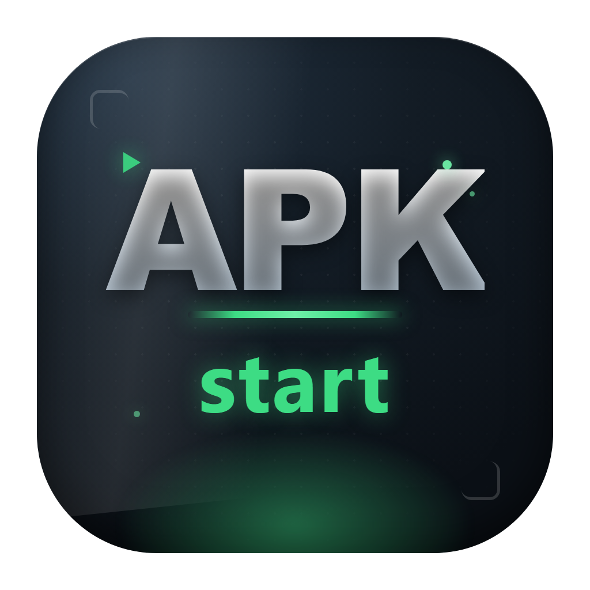

# ApkStart

<p align="center"></p>

<p align="center">
  <a href="README.md">简体中文</a> | 
  <a href="README_en.md"><b>English</b></a> | 
  <a href="README_ar.md">العربية</a>
</p>

[](https://github.com/RoutineMiku/apkstart/actions/workflows/ci.yml)
[](https://github.com/RoutineMiku/apkstart/releases)
[](LICENSE)
[](#)

**An Android application launcher for Windows — Run Android apps just like native Windows desktop software.**

- 🖱️ **Double-click .apk to Install**: After registering `.apk` file association, double-click any APK in Windows File Explorer to automatically parse → install → generate desktop shortcuts, completely without opening any emulator interface.
- 🧩 **Dedicated Desktop Icon per App**: App icons are extracted offline directly from the APK and converted into multi-size `.ico` files. Double-clicking a desktop shortcut launches that app directly, identical to launching native Windows software.
- 🪟 **App as an Independent Window**: Runs in windowed mode (in headless mode Android does not generate VSYNC, leaving the process running with a blank display). ApkStart customizes the window title, applies the genuine app icon, and positions it in mobile phone aspect ratio. **Fullscreen** spans screen height and centers the app; **Windowed Mode** supports freely resizing and dragging while remembering dimensions per app.
- 🔍 **Searchable via Windows Start Menu**: Automatically creates both Desktop and Start Menu (`Programs\ApkStart\`) shortcuts. Type the app name in Windows Search to launch directly, with clean taskbar grouping per application.
- 📁 **Seamless Two-Way File Sharing**: Continuous two-way synchronization between `%USERPROFILE%\ApkStartShared` and Android `/sdcard/ApkStartShared`. Files saved inside Android apps appear immediately on your host PC.
- 🌐 **Full Multi-Language Support**: Complete interface localization for **English (`en`)**, **Arabic (`ar`, full RTL)**, and **Chinese (`zh`)**, with an instant language switcher in Settings requiring no app restart.
- 🪶 **Extremely Lightweight Shell**: Zero third-party runtime dependencies (ZIP, PNG, ICO, and AXML parsers are all hand-crafted in vanilla JS). The runtime launches on demand and auto-reclaims resources when idle.


```
┌────────────────────────────────────────────────────────────┐
│  Desktop Shortcut (Real App Icon .lnk)                     │
│      │  Double-click                                       │
│      ▼                                                     │
│  ApkStart.exe --launch <package>                           │
│      │  Runtime not started? → Auto-launch (QEMU + API 34) │
│      ▼                                                     │
│  Launch via resolved system LAUNCHER entry point           │
│      │  Monitors startup; auto-retries on crash            │
│      ▼                                                     │
│  Emulator Window = App Window (custom title, icon, aspect) │
└────────────────────────────────────────────────────────────┘
```

---

## Ready-to-Use Downloads (Pre-built)

Pre-built releases are published across both sources:

- **GitHub**: [github.com/RoutineMiku/apkstart/releases](https://github.com/RoutineMiku/apkstart/releases)
- **Gitee**: [gitee.com/daily-miku/apkstart/releases](https://gitee.com/daily-miku/apkstart/releases)

### Available Package Formats

| Format | Filename | When to Choose |
|---|---|---|
| **Microsoft Store** | `ApkStart_<version>_x64.msix` | Install from Microsoft Store. Bundled runtime, works offline immediately, managed updates. |
| **Full Portable** | `ApkStart-v*-win64-full.zip` (~830 MB, extracts to ~1.3 GB) | **No installation or download waiting**: Extract and run. Full runtime (emulator + system image) included. |
| **Setup Installer** | `ApkStart-v*-Setup.exe` (~1.3 GB) | Traditional desktop installer with Desktop/Start Menu shortcuts and Windows uninstaller. |
| **Lightweight Portable** | `ApkStart-v*-win64-portable.zip` (~96 MB) | Minimal shell; downloads runtime components on first launch. |

---

## How Screen Fitting Works

The emulator's **physical LCD panel orientation** (`hw.lcd.width/height`) defines the actual canvas geometry. When physical orientation mismatches the app's declared `screenOrientation`, Android forces letterboxing with thick black bars.

ApkStart parses `AndroidManifest.xml` offline during APK installation, calculating whether the app is naturally portrait or landscape:
- **Portrait Apps**: 720×1280 physical panel, upright, full-bleed, density 190 (`sw606dp`) enabling Android tablet multi-column layouts.
- **Landscape Apps**: 1280×720 physical panel, upright, full-bleed.

Only when switching between portrait and landscape does the runtime restart (~40 seconds with title bar progress). Subsequent launches of apps with the same orientation open instantly.

---

## Settings: Categorized & Searchable

Starting from version 0.6.0, settings are organized into eight distinct categories with instant search:

| Category | Description |
|---|---|
| **General & Installation** | Language selection (English / Arabic RTL / Chinese), Runtime status, One-click setup, Boot autostart, Disk usage & cleanup. |
| **Display & Window** | Window mode (Native / Embedded), Auto-fullscreen, Screen orientation, Tablet layout, Android system settings. |
| **Input & Controls** | Mouse wheel modes (Smooth / Native), Keyboard mapping for game controllers. |
| **Performance & Resources** | Resource policies (Resource Saving / Balanced / Smooth), Render quality, Data partition sizing, System language, Prewarm. |
| **Network & Downloads** | Update & download sources (Auto / Gitee / GitHub), Mirror acceleration, Download threads (1–16). |
| **Diagnostics & Repair** | Preflight checks & auto-tuning, Driver compatibility patches, Automated debugging. |
| **Integration & Files** | Desktop shortcuts rebuild, Two-way file sharing folder, File associations. |
| **Updates & About** | Online update check, System manual, Version information. |

---

## Automated Diagnostics (Auto-Debug)

Located in **Settings → Diagnostics & Repair → Automated Diagnostics**. Background tasks inspect your system and categorize issues:

- **Runtime**: Detailed crash reasons, startup lockups, leftover lock files, orphaned emulator processes, corrupted snapshots, hardware acceleration status.
- **Device Connection**: ADB unauthorized prompts, offline state, port conflicts.
- **Storage**: Low disk space warnings, data partition mismatches, shared folder write permissions.
- **Settings**: Conflicts between screen orientation policies and physical panel sizes.
- **Network / Logs**: Guest connectivity, unreachable download sources, error logs.

Every issue includes a one-click automated fix (restart runtime, clear locks, terminate orphans, discard stale snapshots, reset network, etc.).

---

## Building from Source

```powershell
# 1. Install dependencies
npm install

# 2. Run test suite
npm test

# 3. Start development shell
npm start

# 4. Build portable release
node build/pack.js

# 5. Build full portable bundle (with bundled runtime)
node build/pack.js --full

# 6. Build NSIS installer executable (~1.38 GB)
npx electron-builder --win nsis --publish never
```

---

## Runtime Architecture: Fully Isolated & Standalone

ApkStart is completely self-contained. All runtime components are downloaded, verified, and managed inside `%APPDATA%\apkstart\runtime`:

| Component | Source | Size | Purpose |
|---|---|---|---|
| **ADB (platform-tools)** | Google official CDN | ~8 MB | App installation, process management, screenshotting |
| **Android Emulator** | Google official CDN | ~440 MB | QEMU-based virtualization engine with GPU translation |
| **Android 14 System Image** | Google official CDN | ~1.1 GB (compressed) | Generic Google Play x86_64 image with ARM translation layer |
| **AEHD Driver (Optional)** | Google official CDN | ~0.2 MB | Android Emulator Hypervisor Driver for hardware acceleration |

ApkStart **does not inspect, tamper with, or rely on any existing third-party emulators** (such as LDPlayer, BlueStacks, MuMu, or WSA). It uses dedicated ADB port `5044` to prevent interference with Android Studio or host ADB tools.

---

## Frequently Asked Questions

### What if Hardware Acceleration is not enabled?
Windows supports two acceleration backends:
1. **WHPX (Windows Hypervisor Platform)**: Native Windows component. Enable via Settings → Diagnostics → Fix, or run in Admin PowerShell:
   ```powershell
   dism /online /enable-feature /featurename:HypervisorPlatform /all /norestart
   ```
   *Note: Be sure to enable "HypervisorPlatform" (not just "VirtualMachinePlatform"). Restart PC after enabling.*
2. **AEHD**: Google's standalone kernel driver for Intel/AMD CPUs. Click Fix in Settings to install automatically.

### How to connect via ADB from the command line?
ApkStart operates on dedicated port `5044`:
```powershell
$env:ANDROID_ADB_SERVER_PORT = 5044
adb devices
```

---

## Contributing

Contributions and Pull Requests are welcome!
Please ensure `npm test` passes before submitting pull requests.

## License

[MIT](LICENSE).
The repository contains only ApkStart source code and Electron shell logic. Android system images, QEMU binaries, and platform tools are fetched on-demand from official Google sources under their respective licenses.
