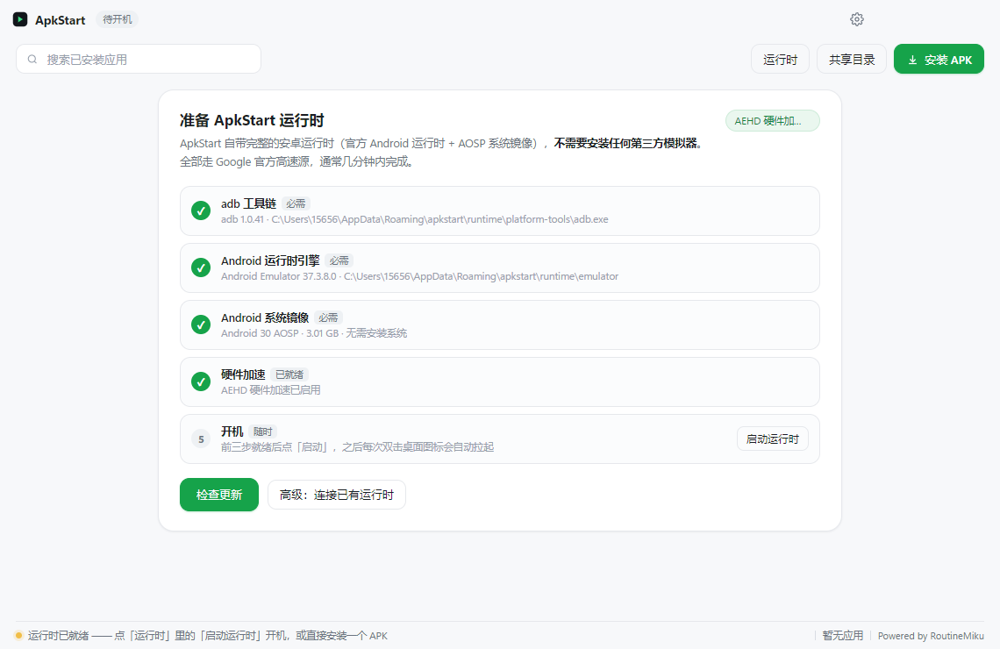
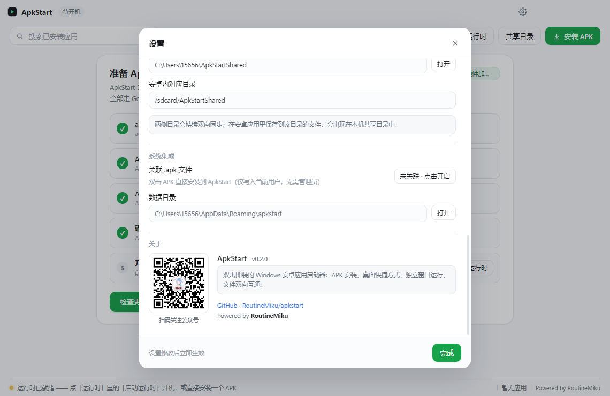
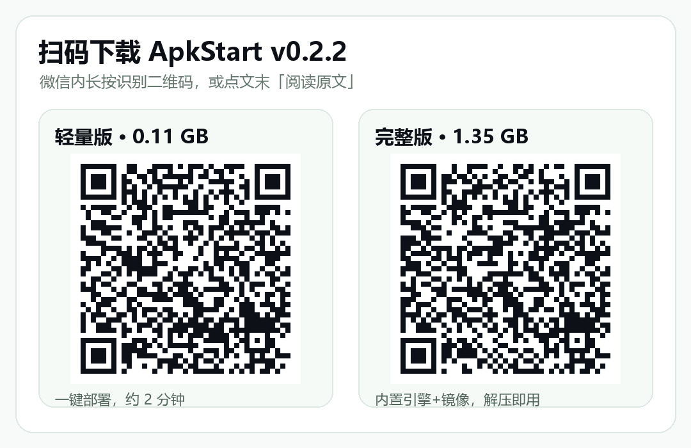

# 双击 .apk，就在电脑上跑安卓应用

想在 Windows 上开一个安卓 App，通常要经历：下载几个 GB 的模拟器 → 装环境 → 找 APK → 拖进模拟器 → 忍受弹窗和风扇狂转。装完还可能来一句 `INSTALL_FAILED_NO_MATCHING_ABIS`——这个包只有 ARM 原生库，装不上。

所以我自己写了一个：**ApkStart**。

它是一个极致轻量的 Windows 安卓应用启动器：把 `.apk` 关联给它，**双击即装**，自动生成桌面快捷方式，每个应用一个独立窗口，电脑和安卓之间还有共享文件夹可以双向拖文件。

## 四个特性，装完就用

**① 双击安装。** 关联 `.apk` 后双击就装，自动读取应用名与图标，桌面快捷方式一步到位，不用开任何模拟器控制台。

**② 独立窗口。** 每个 App 跑在自己的自由缩放窗口里（`am start --windowingMode 5`），互不打扰，跟原生 Windows 程序一样排布。

**③ 文件互通。** `%USERPROFILE%\ApkStartShared` 与安卓内部共享目录打通，电脑里的文件拖进去，App 里直接能打开。

**④ 官方引擎 + 硬件加速。** 底层是 Google 官方 Android Emulator 与 AEHD 驱动，官方源 8 线程并行下载，运行时组件由程序自己校验和管理，壳层零第三方依赖。

## v0.2.2：这次把「麻烦」彻底拿掉了

新版做了两件事。

**一是完整版开箱即用。** 以前首次启动要点一下「一键部署」下载引擎和镜像（约 2 分钟）。现在完整版直接把这些全打包进安装包里：运行时引擎、platform-tools、AEHD 驱动，以及带 ARM 翻译层的 Android 14 兼容镜像。解压双击 `ApkStart.exe`，四项检测全绿，直接进主界面——**零下载、零设置**。

**二是把字节系应用跑通了。** 之前红果短剧这类只有 arm64-v8a 的包，在旧版 API 30 镜像上点完隐私协议就会崩（`libndk_translation` 的 `DoBadTrampoline`）。换成 Android 14 镜像后，新版翻译层解决了这个问题：实测安装成功、进入推荐流、视频正常播放、滑动切视频不崩。

设置里一键开启「ARM 兼容模式」即可，普通 ARM-only 应用同样获益。个别应用若有更深的反模拟检测（校验真实传感器 / 基带）仍可能受限，这点如实说明。

## 下载：两个版本，任选

> 微信公众号正文不支持附加安装包文件，所以这里放的是**直达安装包的二维码**：长按识别即可下载；也可以拉到文末点 **「阅读原文」** 进入 GitHub Release 页面。

| 版本 | 体积 | 适合谁 |
| --- | --- | --- |
| 轻量版 `win64-portable.zip` | 0.11 GB | 首次启动点「一键部署」，自动装好引擎与镜像，约 2 分钟 |
| **完整版 `win64-full.7z.001`（推荐）** | 1.35 GB | 内置全部组件与 ARM 兼容镜像，解压双击即用，零下载零设置 |

完整版是 7z 分卷，用 7-Zip / WinRAR / Bandizip 解压 `.001` 即可；当前版本只有单个分卷。两个版本都是绿色便携，不用管理员安装。

项目完全开源，地址：<https://github.com/RoutineMiku/apkstart>。欢迎 Star、Issue 和 PR；之后发新版只需打 tag，GitHub Actions 会自动构建并发布这两个包。

## 关于作者

**ApkStart 由 RoutineMiku 开发维护**，Powered by RoutineMiku。

微信公众号与抖音的二维码都放在下面，也放进软件的「设置 → 关于」里了，遇到问题欢迎来找我。

抖音号 **RoutineMiku（日常MIKU）**，主页链接：<https://v.douyin.com/9TIIxVCANig/>

---

*项目采用 MIT 许可。轻量版的运行时组件由用户本机从 Google 官方源按需下载；完整版为便利性一并打包，相关组件遵循其各自许可协议。*
